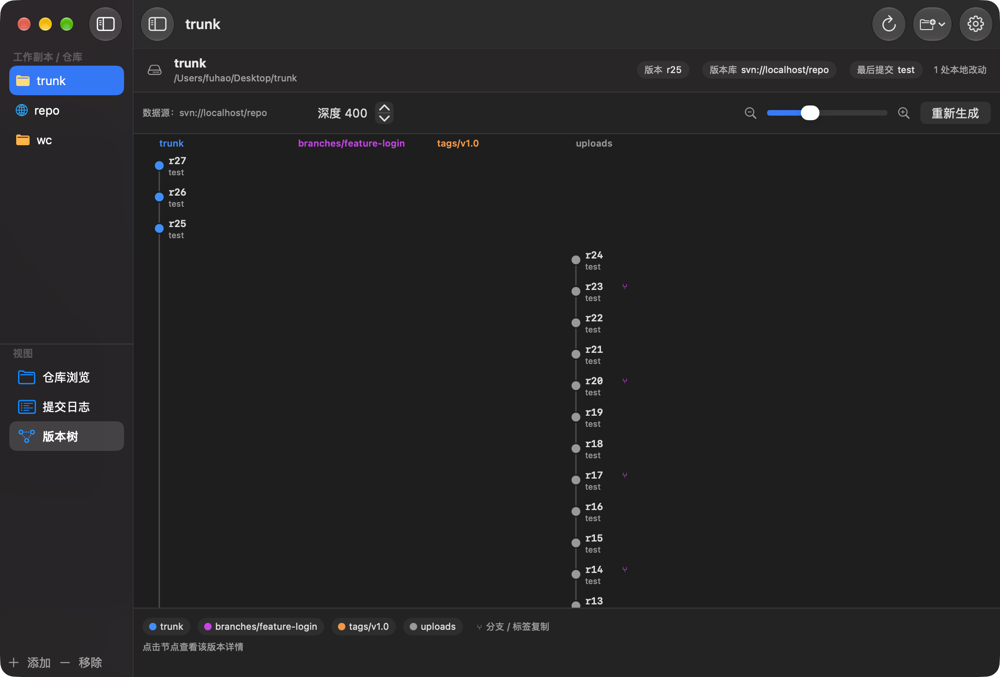
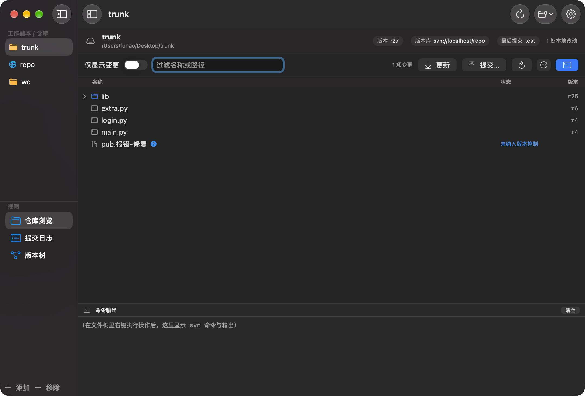
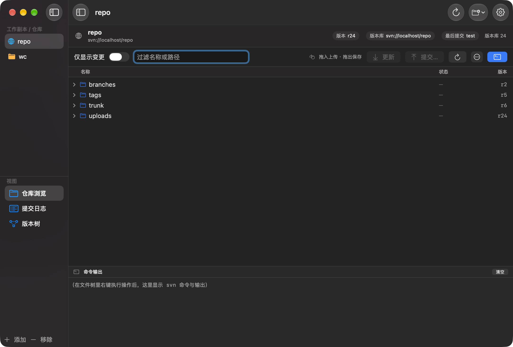
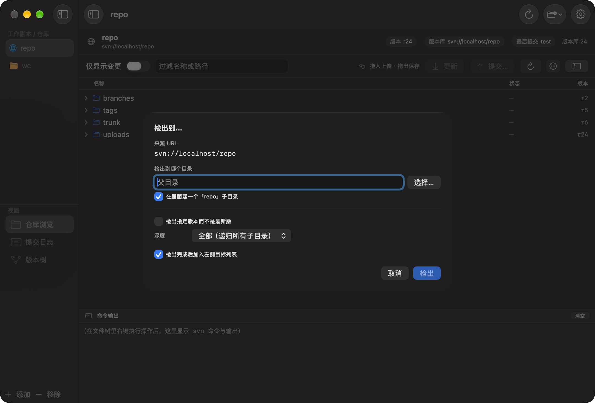

# Torti · Mac 版 TortoiseSVN 替代品

> Torti（小龟）—— 致敬 TortoiseSVN，一只跑在 macOS 上的小乌龟。
> 原名「SVN 可视化」，2026-10-27 更名为 Torti。

参考 TortoiseSVN 的核心工作流，为 macOS 写的一个原生 SwiftUI 客户端。不依赖 Xcode 工程文件，`./build.sh` 即可出 `.app`；底层直接调用本机 `svn` 命令行（Homebrew / 系统自带皆可），因此与 TortoiseSVN 看到的状态、日志、版本关系完全一致。



本地工作副本（状态徽章 / 已删除划线 / 命令面板）与远程仓库：







## 功能

### 1. 仓库浏览 + 文件状态（操作入口也在这里）
- 打开**本地工作副本**或**远程仓库 URL**（URL 模式用 `svn list` 懒加载目录树）。
- 目录树按「名称 / 状态 / 版本」三列对齐，文件图标随类型变化；根目录不再重复一层，直接列内容。
- **双击**文件用系统默认应用打开（等价于访达里的双击）；双击目录展开 / 折叠。远程仓库里的文件没有本地实体，双击时先 `svn export` 一份只读副本到临时目录再打开，同一文件只导出一次（右键还有「打开方式…」「在访达中显示副本」）。
- TortoiseSVN 风格状态徽章：修改（红）、新增（紫）、冲突（红三角）、删除/缺失（红减号）、未纳入版本控制（蓝问号）、忽略（灰）。
- 目录状态取子项中"最严重"的一项聚合显示（标签写「含改动」），一眼能看出哪个目录里有改动；目录自身未纳管/已添加时直接显示该状态。
- 「仅显示变更」切换成平铺变更列表（等价于 TortoiseSVN 的 *Check for modifications*），可按路径过滤。
- 过滤框输入时自动展开并只留下命中的节点。
- 树下方常驻**命令输出**面板（工具栏最右侧的终端图标可收起），每次操作实时打印 `svn` 命令行与输出，长任务可「停止」。
- 左侧边栏由应用自己布局：工具栏最左边的按钮（或 `⌃⌘S`）展开 / 收起，宽度固定 236、状态记忆在 `showSidebar` 里；窗口缩到最小（980×620）也不会被压成一条缝，详情区超出的部分直接裁掉而不是把窗口撑破。

### 2. 提交日志 + 版本树
- `svn log -v --xml` 解析：修订号、作者、时间、提交说明、变更路径（含 `复制自 xxx@rNN`）。
- 支持按作者、提交说明关键字、仅「分支/标签事件」筛选，可调最近 N 条。
- **版本树**：从版本库根目录取日志，按 `trunk` / `branches/*` / `tags/*` 分列，修订号排行，主干纵向连线，分支/标签创建用紫色曲线连到来源修订。支持缩放、滚动、点击节点查看该版本详情，底部有分支图例。

### 3. 远程仓库：浏览 / 检出 / 上传 / 拖出
远程模式（打开的是 `svn://`、`http(s)://`、`file://` 之类的 URL）下，目录树用 `svn list --xml` 懒加载，每个条目右侧显示它的最后提交版本。除了浏览，还能直接在版本库上干活：

| 操作 | 入口 | 实际命令 |
|---|---|---|
| 检出到指定目录 | 右键「检出到…」/ 工具栏 `⋯` | `svn checkout [--revision N] [--depth X] <url> <本地目录>` |
| 导出（不带 .svn） | 右键「导出到…」 | `svn export --force [--revision N] <url> <本地目录>` |
| 上传文件 / 文件夹 | **把访达里的文件直接拖到目录行上**，或右键「上传文件到这里…」 | `svn import -m "上传 xxx" <本地路径> <url>/<name>` |
| 新建子目录 | 右键「新建文件夹…」 | `svn mkdir -m "…" <url>/<name>` |
| 重命名 / 移动 | 右键「重命名…」 | `svn move -m "…" <old> <new>` |
| 删除 | 右键「删除…」 | `svn delete -m "…" <url>` |
| 拖出文件 | **把文件行直接拖到访达 / 桌面 / 邮件** | 远程文件先 `svn export` 到临时目录再交给系统 |
| 打开文件 | **双击文件行**，或右键「打开（版本库副本）」 | `svn export` 到 `$TMPDIR/TortiOpen/…` 后交给系统默认应用 |

细节：
- **检出**弹窗可选目标父目录、是否在里面建同名子目录、检出指定版本号还是 HEAD、检出深度（递归 / 一层 / 仅文件 / 仅目录）；勾选「加入左侧目标列表」则完成后直接切到那个工作副本。
- **拖入上传**：拖动经过目录行时该行会高亮描边；目标目录里已有同名项时会跳过并在命令面板说明（避免误覆盖，要改内容请检出后提交）。整目录拖入会递归导入。
- **拖出**：本地工作副本的文件直接把真实路径交给系统（相当于复制）；远程文件走异步导出，拖到访达时才开始下载，文档大时会稍等一下。
- 本地工作副本里同样可以拖入文件——此时是「复制进目录 + `svn add --parents`」，之后照常「提交…」入库。
- 本地工作副本右键还有「浏览远程版本库…」，按 `svn info` 里的 repository root 直接开一个远程目标（对应 TortoiseSVN 的 Repo-Browser）。
- 上传 / 新建 / 重命名 / 删除都会在命令面板打印完整命令与输出，并自动刷新所在目录。

### 4. 操作：全部走文件树右键菜单
不再单开「操作面板」，右键任意文件或目录即为操作入口（菜单项按选中项状态自动置灰）：

| 菜单项 | 实际命令 | 说明 |
|---|---|---|
| 更新 | `svn update <path>` | 远程仓库模式下不可用 |
| 提交… | `svn commit -m <msg> <paths>` | 弹窗内可勾选要提交的文件、填写说明；勾上的**未纳管文件会自动先 `svn add`** 再提交（等同 TortoiseSVN 的 check-to-add） |
| 查看差异 | `svn diff <paths>` | 输出到下方命令面板 |
| 添加至版本控制 | `svn add <paths>` | 仅未纳管项可用 |
| 还原… | `svn revert -R <paths>` | 二次确认，不可撤销 |
| 删除… | `svn delete <paths>` | 标记删除，需再提交 |
| 追溯 (blame) | `svn blame <file>` | 仅文件 |
| 查看提交日志 | `svn log --xml -v -l 200 <path>` | 切到日志页并只看该路径的历史，页头有橙色范围标签可一键清除 |
| 显示 svn info | `svn info <path>` | 输出到命令面板 |
| 切换 (switch)… | `svn switch <url>` | 仅目录 |
| 清理 (cleanup) | `svn cleanup <path>` | 清掉中断操作留下的锁 |
| 打开 / 打开方式… | — | 文件项菜单最上面两项；双击同理，「打开方式…」可临时挑一个 App |
| 在访达中显示 / 复制路径 | — | 本地模式可用；远程文件是「在访达中显示副本」（先导出） |

多选行为：在「仅显示变更」列表里多选后右键，菜单作用于整个选区；否则只作用于当前项。工具栏也留了「更新」「提交…」「重新检查状态」三个高频入口。

`svn rm` 掉的文件磁盘上已经没有了，但树里仍会以**红色删除线 + 已删除**显示（否则会像凭空消失）。

### 5. 设置
`svn` 可执行文件路径（自动探测 `/opt/homebrew/bin/svn` 等）、服务器凭据与默认账号（详见下一节）、连通性测试。

## 安装

到 [Releases](../../releases/latest) 下载 `Torti-<版本>.dmg`，双击打开镜像，把 **Torti** 拖进 **Applications** 就算装好了。

**首次打开会被 macOS 拦一下**：本应用没有付费 Apple 开发者证书、未做公证（notarization），Gatekeeper 会提示「Apple 无法验证此 App」。任选一种放行，只需一次：

- 在「应用程序」里**右键 Torti → 打开**，弹窗里再点「打开」；
- 或在终端执行：`xattr -dr com.apple.quarantine /Applications/Torti.app`

**系统要求**：macOS 13 Ventura 及以上；通用二进制（Apple Silicon / Intel 都可）。需要本机有 `svn` 命令行：`brew install subversion`（系统自带的老版本也能用）。

## 从源码构建

```bash
git clone https://github.com/TCYS0/Torti-.git && cd Torti-
./build.sh                  # 编译 + 打包 Torti.app + dist/Torti-<版本>.dmg
open "Torti.app"
```

- `./build.sh --app-only`：只出 `.app`，不封 DMG（本地调试快一点）
- 要求：macOS 13+、Xcode Command Line Tools（`swiftc`）、`svn` 命令行
- 编译带 `--arch arm64 --arch x86_64`，产物是通用二进制

## 发布新版本

版本号写在 `Resources/Info.plist` 的 `CFBundleShortVersionString`。改完打个 tag 推上去，GitHub Actions（`.github/workflows/release.yml`）会自动构建 DMG 并挂到 Release：

```bash
/usr/libexec/PlistBuddy -c "Set :CFBundleShortVersionString 1.1.0" Resources/Info.plist
git commit -am "Bump version to 1.1.0"
git tag v1.1.0 && git push --follow-tags
```

本地直接出包：`tools/make-dmg.sh [版本号]` → `dist/Torti-<版本>.dmg`（附 `.sha256`）。

如果以后有了 Apple Developer Program（$99/年），导入证书后设置环境变量再打包，脚本会自动切成 Developer ID 签名 + 公证 + 盖章，用户下载就无需右键放行：

```bash
export CODESIGN_IDENTITY="Developer ID Application: Your Name (TEAMID)"
export APPLE_ID="you@example.com" APPLE_TEAM_ID="TEAMID" APPLE_APP_PASSWORD="abcd-efgh-ijkl-mnop"
./build.sh
```

应用图标是**矢量绘制**的（`tools/gen-icon.swift`，CoreGraphics 逐尺寸重绘 → `iconutil` 打包成 `Resources/AppIcon.icns`），不是位图放大：

```bash
swiftc -O -parse-as-library tools/gen-icon.swift -o /tmp/gen-icon
/tmp/gen-icon /tmp/AppIcon.iconset
iconutil -c icns /tmp/AppIcon.iconset -o Resources/AppIcon.icns   # 之后 ./build.sh 即可
```

设计：现代 macOS 的浅色卡片底板（内高光 + 底部内阴影 + 细边框），上面是一张**紫蓝 → 蓝 → 青的渐变「版本图」**——主干竖线、平滑分叉曲线、分支竖线，节点是实心色点 + 白色内圈（现代 git 图那种 hollow dot），图形带轻微投影。16/32/64px 自动简化成主干 + 折线分支 + 三个节点，保证小尺寸也认得出。

想换配色只改 `tools/gen-icon.swift` 顶部的 `cTop / cMid / cEnd` 三个常量（现在是紫蓝 → 蓝 → 青）。

> 若 `swift build` 报 `sandbox-exec: sandbox_apply: Operation not permitted`，说明当前终端被外層沙箱限制，加 `--disable-sandbox` 即可（`build.sh` 已默认带上）。

## 账号密码 / 认证

三种填法，任选其一：

1. **打开远程仓库时直接填**：工具栏「打开 › 打开仓库 URL…」，弹窗里的「账号（可选）」区填用户名、密码，勾选「记住密码」后会按该服务器的主机名保存。
2. **按服务器保存**：工具栏右上齿轮（或 `⌘,`）→「服务器凭据 › 添加服务器账号…」，填主机名（如 `svn.example.com`，不含协议和端口）、用户名、密码。连接时按 URL 的主机名自动匹配。
3. **默认账号**：设置里的「默认账号」，没有单独配置的服务器都用它。

命令实际执行形态：

```
svn --non-interactive --username <user> --password <pass> --no-auth-cache <子命令> …
```

- 密码存放在 `~/Library/Application Support/Torti/credentials.json`（权限 `600`）。
- **为什么不用系统钥匙串**：本应用是 ad-hoc 签名，每次 `./build.sh` 重新构建签名都会变，钥匙串里的条目换签名后读不到，还会弹系统授权框把界面卡住——那才是"密码存了却用不上"的根因。600 权限的凭据文件在重建后依然稳定可用。
- 认证/连接失败时，控制台会打印实际执行的命令（密码打码）、退出码和 svn 原始报错，并提示到「设置 › 服务器凭据」补账号。
- 设置页底部有「连通性测试」：填 URL 点一下就知道账号通不通。

## 常见问题

| 现象 | 原因与处理 |
|---|---|
| 所有操作都提示"找不到 svn 可执行文件" | 「设置 › SVN 命令行」里填的是**仓库地址**而不是 svn 程序路径。应用检测到 `://` 会给出橙色提示，点「改回 /opt/homebrew/bin/svn」即可；下次启动时若路径不可执行也会自动回退到检测值。 |
| 远程仓库报 `E170001 Can't get username or password` | 没配上该主机的账号：设置 › 服务器凭据里添一条，或打开 URL 时直接填。 |
| **本地工作副本**点「更新 / 提交 / 日志」报 `E170001` | 已修。工作副本的地址是磁盘路径，取不到主机名，凭据就匹配不上。现在会先 `svn info` 拿到 `Repository Root`（如 `svn://localhost/repo`），再按它的主机名取账号密码。旧版本才会这样，重新打开应用即可。 |
| 在访达/命令行新建的文件，树里看不到 | 已修：刷新按钮（↻）现在除了重跑 `svn status`，还会按磁盘实际内容重读已展开的目录；`svn rm` 掉的文件仍以红色删除线保留。 |
| 报 `E210005 No repository found` | **地址不对**（典型是 `svn://host` 漏了 `/repo`）。应用现在会把这类错误单独判定为"地址不对"而不是笼统的认证失败。 |
| 报 `E170013 Unable to connect` | 服务器地址/端口/协议不对，或 svnserve/httpd 没起；先用「连通性测试」在终端外验证一遍。 |
| 文件树显示"无法读取这个位置" | 树里会直接给出错误首行 + 「重试」+「配置凭据…」按钮，不用再切到命令输出里找原因；非远程模式下第二个按钮变成「检查 svn 路径…」。 |
| 命令输出里中文变成 `{U+6B63}` 这种转义 | 已修：给子进程注入 `LC_ALL/LANG=en_US.UTF-8`，并按 UTF-8 → GB18030 顺序解码输出。 |
| 版本树是空的 | 点「重新生成」；版本树取的是**版本库根**的日志，工作副本只 checkout 了 trunk 也能看到全部分支，前提是 `svn info` 能拿到 repository root。 |
| 拖文件进去没反应 | 先看是不是拖到了**文件行**上——只有目录行（和树的空白处）接受拖放，拖动时目标行会出现蓝色描边。另外远程上传需要该路径的写权限。 |
| 拖出去的文件名/内容不对 | 远程文件是拖到目标位置那一刻才 `svn export` 的，命令面板能看到导出命令；如果目标应用不支持文件 URL 拖放（少数编辑器），改用右键「导出到…」。 |
| 上传时提示"已存在同名项，跳过" | `svn import` 不能覆盖已有路径。要改内容就检出成工作副本改完再提交；确实要替换，先右键「删除…」再上传。 |
| 双击远程文件打开的是旧内容 | 打开的是 `$TMPDIR/TortiOpen/…` 里的只读副本，同一文件只导出一次。版本库更新过内容时，重启应用或删掉该临时目录即可；也可以用右键「导出到…」拿一份最新的。 |
| 双击文件没反应 / 提示"本地磁盘上没有这个文件" | 该文件已被 `svn delete` 或工作副本里缺失，磁盘上确实没有实体。远程模式请确认服务器可连（导出失败会在命令面板给出 svn 报错）。 |

## 想先试玩？

```bash
./tools/make-demo-repo.sh     # 生成 /tmp/svntest：含 trunk/branches/tags 与本地改动
```
然后在应用里「打开本地工作副本」选 `/tmp/svntest/wc`，切到「版本树」点「重新生成」。

## 代码结构

```
Sources/Torti/
  App.swift              App 入口、AppState（目标列表、设置持久化）
  Models.swift           数据模型（状态枚举、日志、版本图结构）
  SVNExecutor.swift      svn 进程封装 + status/info/log/list XML 解析 + 版本图构建
  RepoModel.swift        单个目标的视图模型（加载、状态、日志、操作）
  Views/
    ContentView.swift    侧边栏 / 头部信息条 / 空状态
    FileBrowserView.swift 目录树（含右键菜单、拖入拖出）+ 变更列表
    Operations.swift      提交窗口 / 切换窗口 / 命令输出面板
    Transfer.swift        检出 / 导出 / 新建目录 / 重命名 / 远程删除弹窗 + 拖放工具
    LogView.swift        日志列表 + 详情
    RevisionGraphView.swift Canvas 绘制的版本树
    SettingsView.swift    设置
```

## 与 TortoiseSVN 的差异 / 后续可做

- **Finder 图标叠加 + 右键菜单**需要单独的 Finder Sync 扩展（App Extension，必须在 Xcode 里配置 target 并签名），当前版本靠应用内列表展示状态。
- **Diff 对比视图**（并排/统一 diff、语法高亮）尚未实现，右键「查看差异」把 `svn diff` 文本输出到命令面板。
- 合并向导（merge wizard）、修订图导出图片、提交前 hook 检查等按需再补。
- 目前把文件拖进**访达**是复制；拖进本应用窗口才是上传/入库。TortoiseSVN 的「拖放自动触发 commit」那种交互需要 Finder Sync 扩展才能做到。
- 双击打开远程文件拿到的是**只读副本**，不会回传版本库；要改内容请先「检出到…」成工作副本再提交。
- 双击目录是展开/折叠，不是「进入」——树的展开状态本身就是这样组织的。

## 协议

[MIT License](LICENSE) © 2026 Fuhao

Torti 与 TortoiseSVN 项目无隶属关系，名称中的 "TortoiseSVN" 商标归其作者所有 —— 本项目只是在交互上向那只乌龟致敬。
